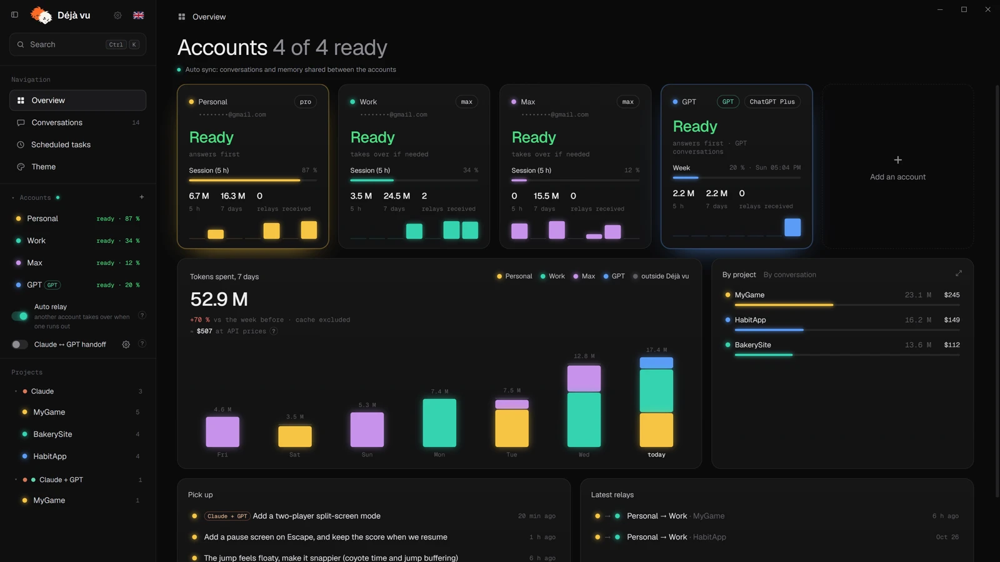
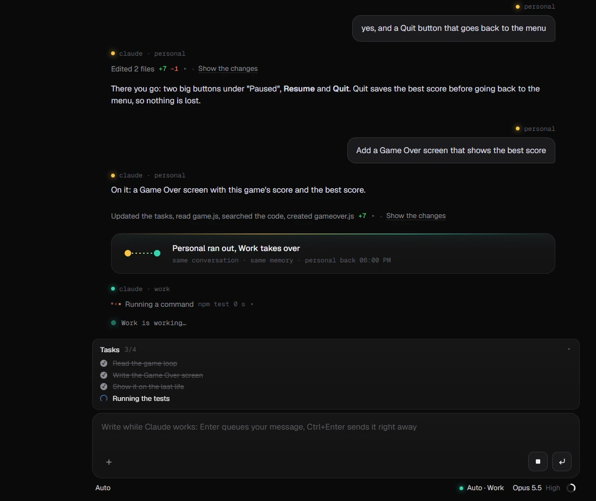
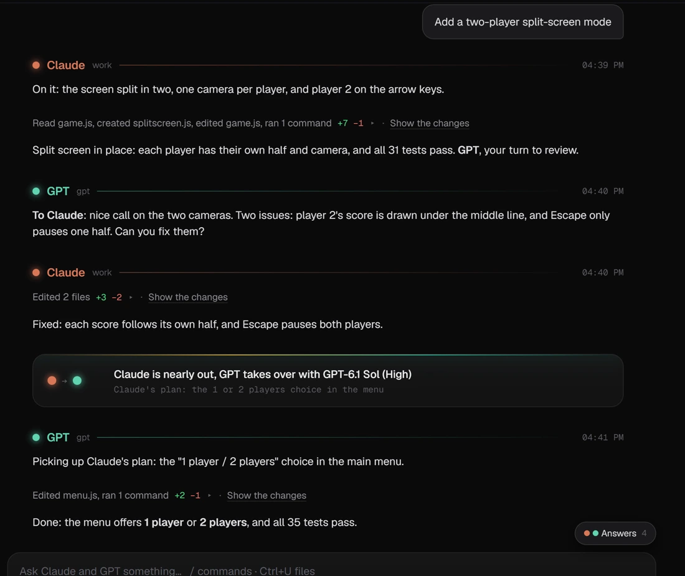
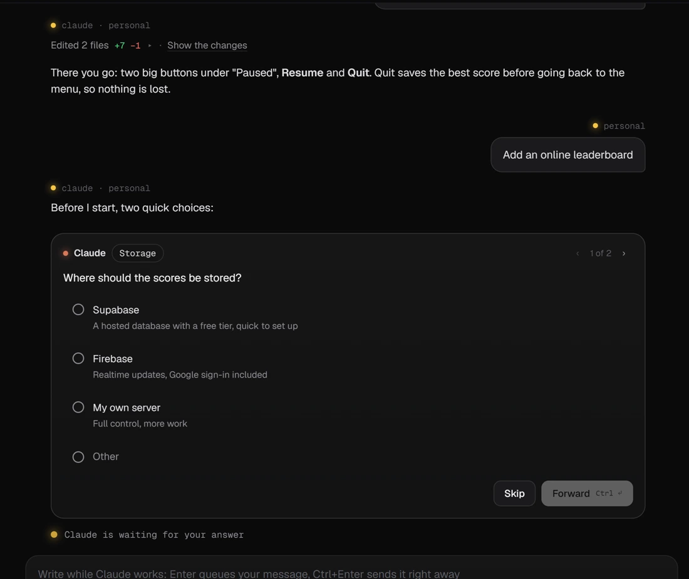
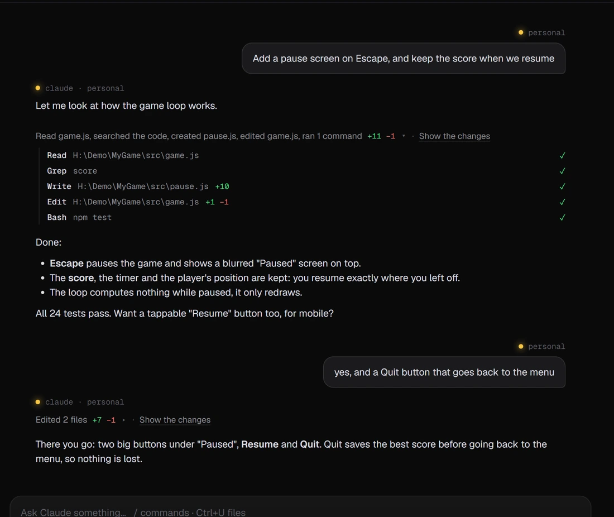

  

<h1 align="center">Déjà vu</h1>

  <b>All your Claude and ChatGPT accounts, as one.</b> 
  A Windows app that runs the real Claude Code and the real Codex on every account you have.

<b>English</b> · <a href="README.fr.md">Français</a>

> [!NOTE]
> **Open source in a few days.** The code and the installer land here very soon.
> ⭐ Star the repo and follow [@TheFrenchPepeAI](https://x.com/TheFrenchPepeAI) to try it first.

## Why

You're deep in a task and your Claude account hits its limit. So you log out, log back in, copy
everything, explain it all again… and lose your train of thought.

Déjà vu puts all your accounts in one app, so that never happens again.

## What it does

- **Never lose the thread.** When an account runs out mid-task, the next one picks up the same
  conversation exactly where it left off, its to-do list included.
- **Everything synced.** Same conversations, same memory, same connectors, same plugins on every
  account.
- **Not a knock-off.** It runs the real Claude Code and the real Codex: tools, modes, models,
  terminal, browser, diffs, commands, questions with choices, the task list… it's all there.
- **Claude and GPT in the same chat.** One codes, the other reviews. When one side runs out, the
  other takes over.
- **Everything under control.** Live limits for every account, what you spend, and what it would
  cost at API prices.
- **Living themes.** ASCII, voxels… or describe your own and Claude makes it.

| | |
|---|---|
|  |  |
| One account runs out, the next carries on, to-do list and all. | Claude and GPT in the same chat, each under its own name. |
|  |  |
| Questions with choices, as in the Claude app. | The work folded in one line, its steps one click away. |

The app speaks English and French (the flag next to « Déjà vu » switches).

## What you need

Windows 10 or 11 (64-bit), and your own Claude and/or ChatGPT accounts.

---

Déjà vu is an independent project, not affiliated with Anthropic or OpenAI. Claude is a
trademark of Anthropic, ChatGPT a trademark of OpenAI.
